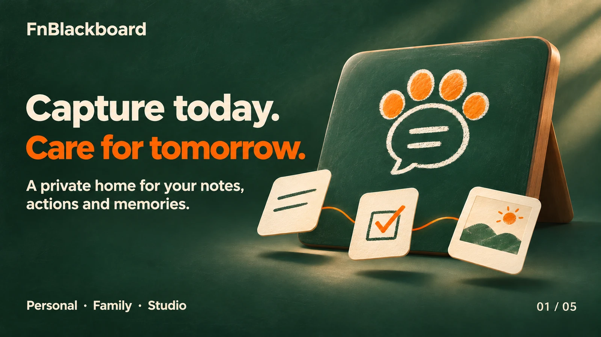

# FnBlackboard — English brand carousel

Product introduction assets for FnBlackboard. Keep the repository's existing README, release files and licensing notices.

Five static WebP images, 1600×900, under `market/evergreen-v1/en/`. Display in numerical order. Slide 05 is explicitly marked **FUTURE VISION**; it does not imply that all envisioned capabilities are available today. These are brand illustrations, not application screenshots.

| Order | Image |
|---|---|
| 01 |  |
| 02 |  |
| 03 |  |
| 04 |  |
| 05 |  |

Use public raw image URLs for image embedding, not GitHub blob-view URLs. Verify all published URLs without authentication. This asset note does not change the existing product or repository license.
