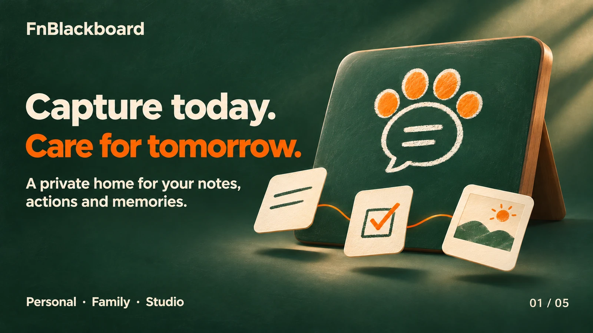
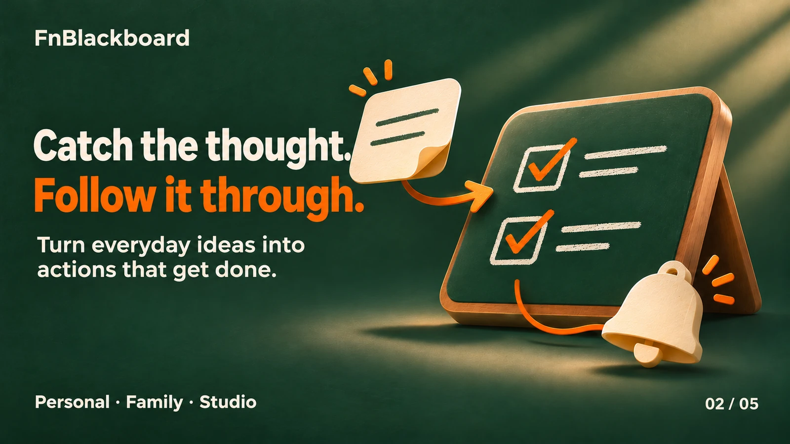
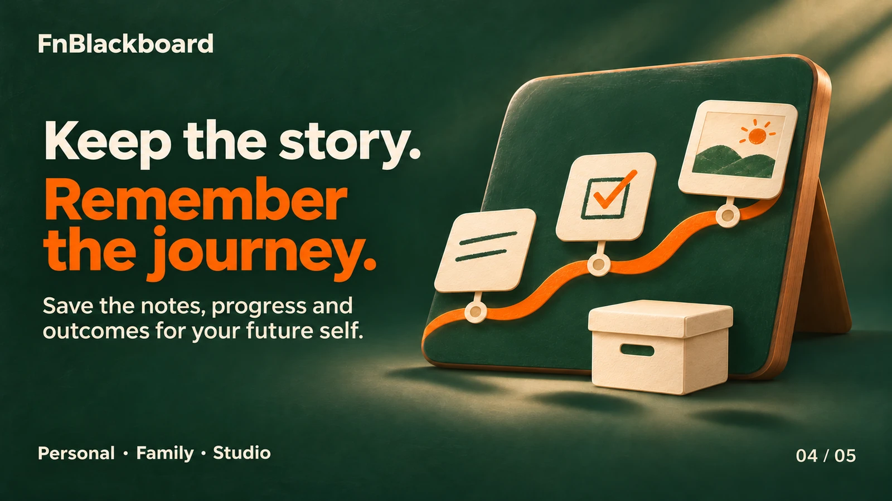
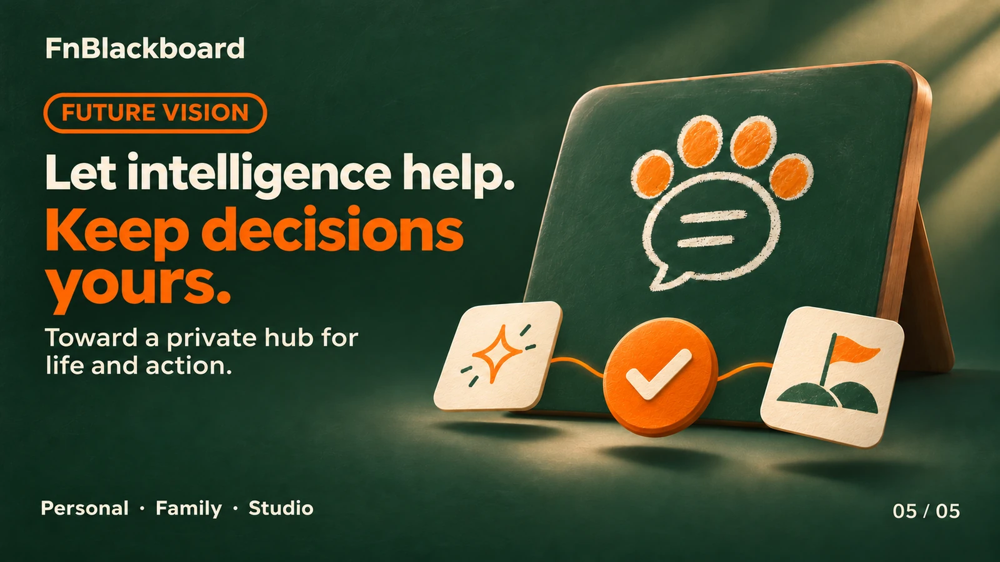

# FnBlackboard / 飞牛小黑板

FnBlackboard（飞牛小黑板）是一款适用于 fnOS 的第三方轻量笔记、任务与多人协作文档工具。

## 下载

请前往 [GitHub Releases](https://github.com/Digit-Space2021/FnBlackboard/releases/latest) 下载与设备 CPU 架构匹配的安装包：

- x86 / AMD64
- ARM64

## 更新

FnBlackboard 支持用户主动查询公开发布版本信息。通过飞牛应用中心安装的用户建议优先通过应用中心更新。

## 隐私与许可

- 隐私说明：[privacy.html](docs/privacy.html)
- 使用与版权说明：[TERMS.txt](docs/TERMS.txt)
- 第三方开源软件许可：[THIRD_PARTY_NOTICES.txt](docs/THIRD_PARTY_NOTICES.txt)

## 源代码

FnBlackboard 当前为免费软件，但暂不公开其自有源代码。公共仓库仅用于版本发布、更新信息与用户支持。

## AI 辅助开发说明

本项目开发过程中借助 AI 工具进行代码分析、调试辅助、文档整理与界面优化；功能设计、测试验证、版本发布与后续维护责任由开发者承担。

## 平台声明

FnBlackboard 为第三方独立应用。“飞牛”、fnOS 及相关名称和标识归其各自权利人所有。本项目使用相关名称仅用于说明适配平台及运行环境，不表示官方隶属、授权或背书关系；如平台审核提出要求，将按审核意见调整。

## 问题反馈

请通过本仓库 Issues 反馈问题。

## English introduction images

Capture today. Care for tomorrow.

Brand illustrations, not application screenshots. The fifth image presents a future vision; features depend on the current release.

